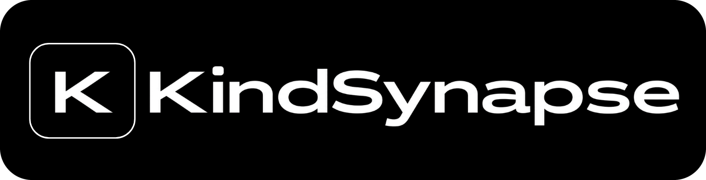

<div align="center">



# ⚡ FaceFlux

### *Super Fast, CPU-Friendly Face Swapping & Morphing for Video*

[](https://python.org)
[](https://opencv.org)
[](https://developers.google.com/mediapipe)
[](https://gradio.app)
[](LICENSE)

**No GPU? No problem.** FaceFlux performs seamless video face swapping and morphing without heavyweight neural networks, hallucinating diffusion models, or gigabytes of VRAM.

---

### ⭐ If FaceFlux saved your CPU, [star the repo](https://github.com/) to show support! ⭐

---

</div>

## 🎬 Example in Action

FaceFlux morphs any target face in a video towards a reference face in seconds. Here is a live showcase with the bundled examples:

<div align="center">

| 🎬 Target Video (`examples/input.mp4`) | 👤 Source Reference (`examples/reference.jpg`) | 🚀 Morphed Output (`examples/output.mp4`) |
| :---: | :---: | :---: |
| <video src="examples/input.mp4" controls autoplay loop muted playsinline width="290" style="max-height: 200px; border-radius: 8px; vertical-align: middle;"></video><br><sub>[▶️ Open input.mp4](examples/input.mp4)</sub> | <br><sub>[🖼️ Open reference.jpg](examples/reference.jpg)</sub> | <video src="examples/output.mp4" controls autoplay loop muted playsinline width="290" style="max-height: 200px; border-radius: 8px; vertical-align: middle;"></video><br><sub>[▶️ Open output.mp4](examples/output.mp4)</sub> |

</div>

> 💡 **Try it yourself in 1 command:**
> ```bash
> python app.py
> ```
> Open your browser at `http://127.0.0.1:7860`, load the bundled sample from the **Examples** panel, and hit **Generate Morph 🚀**!

---

## ⚡ Why FaceFlux?

- 🚀 **100% CPU Native**: Runs effortlessly on standard laptops and CPU instances without CUDA or TensorRT.
- 🎯 **Zero Hallucination**: Pure deterministic computer vision — preserves original expressions, head tilt, and video lighting.
- 📐 **Sub-pixel Alignment**: Powered by MediaPipe's 468+ high-density 3D facial landmarks.
- 🎛️ **Intuitive Fine-Tuning**: Granular sliders for blend strength, mesh density, resolution, and feathered edge falloff.
- 🖥️ **Ready-to-Use Web UI**: Built-in interactive Gradio app with live progress tracking.

---

## 🏗️ Architecture & How It Works

Traditional AI face swappers (RoOP, InsightFace, SimSwap) rely on heavy latent embeddings and neural decoders. FaceFlux takes a fundamentally different, ultra-lightweight approach grounded in **computational geometry and piecewise affine warping**:

```
 ┌──────────────────────┐      ┌──────────────────────┐
 │  Input Video Frame   │      │   Reference Image    │
 └──────────┬───────────┘      └──────────┬───────────┘
            │                             │
            ▼                             ▼
┌────────────────────────────────────────────────────────┐
│ 1. 3D Face Landmarker (Google MediaPipe, 468 points)   │
└───────────────────────────┬────────────────────────────┘
                            │
                            ▼
┌────────────────────────────────────────────────────────┐
│ 2. Convex Hull & Gaussian Feathered Alpha Mask         │
└───────────────────────────┬────────────────────────────┘
                            │
                            ▼
┌────────────────────────────────────────────────────────┐
│ 3. Geometric Interpolation: m = (1-α)·L_frame + α·L_ref│
└───────────────────────────┬────────────────────────────┘
                            │
                            ▼
┌────────────────────────────────────────────────────────┐
│ 4. Delaunay Triangulation (cv2.Subdiv2D on m)          │
└───────────────────────────┬────────────────────────────┘
                            │
                            ▼
┌────────────────────────────────────────────────────────┐
│ 5. Piecewise Affine Warping & Cross-Dissolve           │
│    W_frame -> m   &   W_ref -> m                       │
└───────────────────────────┬────────────────────────────┘
                            │
                            ▼
┌────────────────────────────────────────────────────────┐
│ 6. Feathered Alpha-Blend Composite into Frame          │
│    Region = (1 - Mask) · Frame + Mask · MorphedFace    │
└───────────────────────────┬────────────────────────────┘
                            │
                            ▼
               ┌─────────────────────────┐
               │   Output Video Stream   │
               └─────────────────────────┘
```

### The 4 Pipeline Stages

1. **Facial Mesh Extraction**:
   - Uses MediaPipe Face Landmarker to extract high-precision $(x, y)$ coordinates.
   - Computes a convex hull around the perimeter and constructs a feathered region-of-interest (ROI) mask via Gaussian blurring (`cv2.GaussianBlur`).
2. **Intermediate Mesh Interpolation**:
   - Given blend strength $\alpha \in [0, 1]$, target landmark positions $m$ are computed as:
     $$m = (1 - \alpha) \cdot L_{\text{frame}} + \alpha \cdot L_{\text{ref}}$$
3. **Delaunay Triangulation & Piecewise Warping**:
   - OpenCV's `Subdiv2D` breaks the facial surface into hundreds of non-overlapping triangular facets.
   - Each triangle is independently warped using affine transformation matrices (`cv2.getAffineTransform` + `cv2.warpAffine`), producing smooth geometric deformation without tearing.
4. **Alpha-Feathered Compositing**:
   - The transformed face is blended into the original video frame using the smoothed mask, eliminating harsh seam borders and blending with natural skin tones.

---

## 🚀 Quick Start

### 1. Clone & Setup

```bash
git clone https://github.com/your-username/faceflux.git
cd faceflux
```

### 2. Install Requirements

```bash
pip install -r requirements.txt
```

*(On Linux / Debian instances, make sure OpenGL libraries are installed: `sudo apt-get install -y libgl1 libgles2 libegl1`)*

### 3. Launch App

```bash
python app.py
```
Then navigate to `http://localhost:7860` in your web browser.

---

## 🎛️ Parameter Guide

| Parameter | Recommended | Description |
| :--- | :---: | :--- |
| **Face Resolution** | `512` | Crop resolution for the face bounding box (256 - 768). Higher values yield crisper detail. |
| **Quality** | `1` - `4` | Controls landmark mesh sampling step ($step = 5 - \text{Quality}$). Higher quality uses more mesh points for tighter alignment. |
| **Feather (%)** | `0.12` | Kernel size percentage for Gaussian blur along the mask edge. Softens boundary transitions. |
| **Strength** | `-0.35` | Face interpolation factor ($\alpha$). Controls how prominently the reference face identity is morphed into the video face. |

---

## 🌟 Support & Community

If you find FaceFlux useful for your projects or experiments:
- ⭐ **Star this repository on GitHub** to help others find it!
- 🐛 Open an issue if you encounter bugs or want to suggest features.
- 🌐 Connect with the author: [nihalgazi.com](https://nihalgazi.com) | [@NihalGazi_](https://x.com/NihalGazi_)

---

<div align="center">
<sub>Crafted with precision by <b>KindSynapse</b></sub>
</div>

